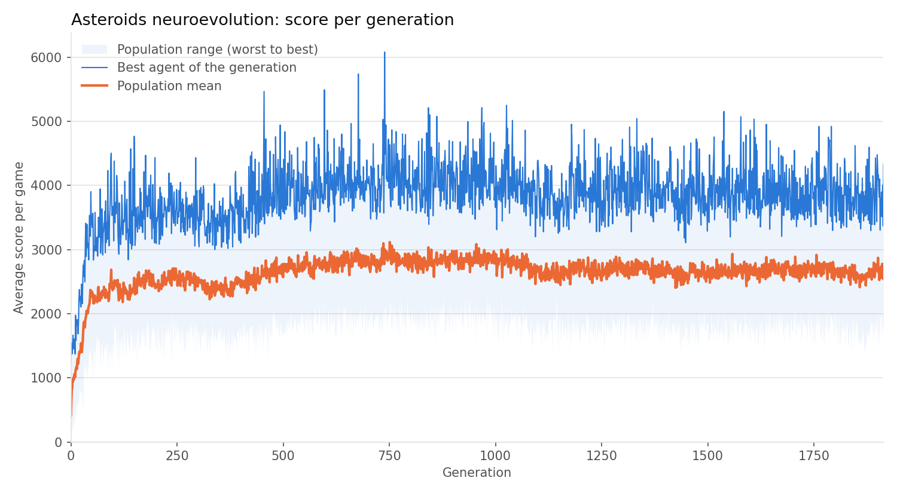
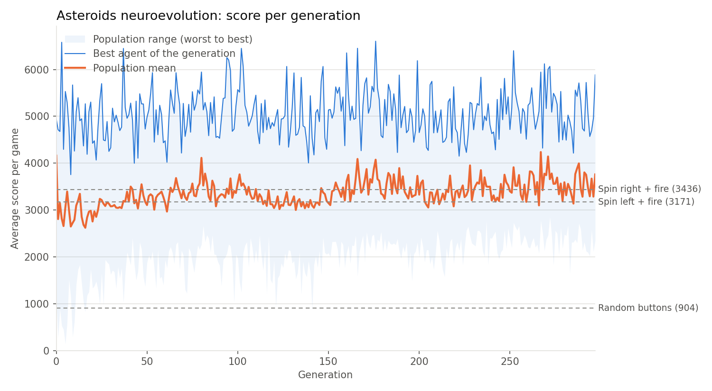

# Asteroids com Neuroevolução

Agente que aprende a jogar **Asteroids** (Atari 2600, via [Arcade Learning Environment](https://ale.farama.org/)) usando **neuroevolução**: um algoritmo genético que evolui os pesos de uma rede neural, usando a pontuação do jogo como *fitness*.

O agente final faz **3954 pontos por partida em média**, contra **3436** da melhor estratégia fixa ("girar e atirar") e **904** de botões aleatórios, em 300 partidas que ele nunca viu durante o treino.

## Resultados

Placar oficial ([`results/baselines.csv`](results/baselines.csv)), 300 partidas de teste, todos os agentes jogando exatamente as mesmas partidas:

| Agente | Pontos por partida |
|---|---|
| Botões aleatórios | 904 ± 26 |
| Girar para a esquerda + atirar | 3171 ± 95 |
| Girar para a direita + atirar | 3436 ± 93 |
| Agente evoluído do zero (experimento 1) | 2695 ± 70 |
| **Agente evoluído a partir do girar e atirar (experimento 2)** | **3954 ± 107** |

*(± = erro padrão da média)*

Comparando partida a partida com o "girar para a direita + atirar", o agente final faz **+518 ± 149 pontos**, vence em **59%** das partidas e sobrevive mais tempo (1959 contra 1831 passos por partida).

### Experimento 1: do zero



População iniciada com pesos aleatórios, treinada por ~9 horas (1914 gerações). A média da população sobe rápido nas primeiras ~500 gerações e depois estabiliza em ~2700, **abaixo** das estratégias fixas.

Este experimento foi rodado antes de duas melhorias descritas em [Como funciona](#como-funciona): cada agente jogava partidas aleatórias diferentes (e não as mesmas da sua geração), e a validação usava 30 partidas aleatórias em vez de 50 fixas.

Analisando os botões que o melhor agente aperta (52% RIGHTFIRE, 47% UPRIGHT), descobrimos que **a evolução reinventou sozinha o "girar e atirar"**, mas girando enquanto acelera (UPRIGHT) em vez de só girar (RIGHT). A nave se desloca, colide mais e a partida dura menos.

### Experimento 2: a partir do "girar e atirar"



A população foi iniciada a partir de uma rede com os pesos ajustados à mão para reproduzir exatamente o "girar para a direita + atirar" (conferido: mesmas ações e mesma pontuação nas mesmas partidas). Em 2 horas (298 gerações), a média da população passou a ficar **acima** da estratégia fixa.

O agente final mantém a base de girar e atirar (49,8% RIGHT, 49,8% RIGHTFIRE) e aprendeu um comportamento novo: **DOWNFIRE em 0,4% dos passos** (~8 vezes por partida). No Asteroids do Atari, o botão para baixo ativa o hiperespaço (a nave some e reaparece em outro ponto). Pela frequência baixa e pela maior sobrevivência, o agente parece usá-lo em situações específicas, decididas a partir da RAM do jogo.

## Como rodar

Requer Python 3.13.

```bash
pip install -r requirements.txt

python evolucao.py      # treina (por tempo, ver MAX_HOURS) e salva em results/
python baselines.py     # placar: agente treinado x estratégias de referência (300 partidas)
python plot.py          # gera results/evolution.png
python play.py          # abre o jogo e mostra o agente treinado jogando (3 partidas)
```

Variações úteis:

```bash
python play.py 10                                   # assistir 10 partidas
python plot.py results_run1                         # gráfico do experimento 1
python baselines.py results_run1/best_agent.npz     # placar de outro agente
```

> Com `RESUME = True`, rodar `evolucao.py` de novo **continua** o treino salvo em `results/` e altera esses arquivos. Para um experimento novo, mova a pasta `results` antes.

## Estrutura

| Arquivo | Conteúdo |
|---|---|
| [`asteroids_neuroevolucao.py`](asteroids_neuroevolucao.py) | Ambiente, rede neural (`Agent`), salvar/carregar pesos e a rede do "girar e atirar" |
| [`evolucao.py`](evolucao.py) | Algoritmo genético: avaliação, seleção, mutação, elitismo, validação e laço de treino |
| [`baselines.py`](baselines.py) | Estratégias de referência e o placar final |
| [`plot.py`](plot.py) | Gráfico da evolução |
| [`play.py`](play.py) | Mostra o agente jogando |
| `results/` | Experimento 2: agente final, histórico, placar e gráfico |
| `results_run1/` | Experimento 1: agente, histórico e gráfico |

## Como funciona

### O agente (rede neural)

```
RAM do Atari (128 bytes, / 255)  ─┐
                                  ├─► 142 entradas ─► 32 neurônios (tanh) ─► 14 notas ─► argmax = botão
ação anterior (one-hot, 14)      ─┘
```

- **Entrada pela RAM**: o estado do jogo são os 128 bytes de memória do Atari, em vez da imagem da tela.
- **Ação anterior como entrada**: no Asteroids, segurar FIRE dispara uma única vez; para atirar de novo é preciso soltar o botão. Como a rede não tem memória, passamos a ação anterior (em one-hot) para que ela consiga alternar o tiro.
- **Inicialização escalada** (pesos divididos por √entradas): com pesos sem escala, medimos 74% dos neurônios ocultos saturados em ±1, o que deixa a rede insensível a mutações pequenas. Com a escala, nenhum ficou saturado.

### O algoritmo genético

A cada geração:

1. **Avaliação**: cada agente joga 6 partidas, em paralelo nos núcleos da CPU. A nota (fitness) é a média de pontos.
2. **Elitismo**: os 2 melhores passam para a próxima geração sem alteração.
3. **Seleção por torneio**: para cada filho, 3 agentes são sorteados e o de maior nota vira pai. Os melhores têm mais chance, mas os medianos ainda participam, o que mantém a diversidade.
4. **Mutação**: o filho é uma cópia do pai em que cada peso tem 10% de chance de receber um ruído gaussiano (desvio 0,05).

| Parâmetro | Valor |
|---|---|
| População | 40 |
| Partidas por avaliação | 6 |
| Limite de passos por partida | 10000 |
| Taxa de mutação | 0,1 |
| Intensidade da mutação | 0,05 |
| Elite | 2 |
| Tamanho do torneio | 3 |

### Partidas iguais para todos (redução de ruído)

O mesmo agente pode fazer de ~1000 a ~6000 pontos dependendo da partida (desvio de 1300 a 2100 pontos por partida). Com 6 partidas, a nota de um agente chegava a errar ~600 pontos só por sorte, e a seleção escolhia pais praticamente ao acaso.

Para corrigir isso, **todos os agentes de uma geração jogam as mesmas partidas** (mesmas sementes do jogo). Assim, a diferença de nota entre dois agentes vem do comportamento deles, e não de terem pegado partidas mais fáceis. As sementes mudam a cada geração para que ninguém "decore" as partidas.

### Treino, validação e teste separados

| Conjunto | Sementes | Uso |
|---|---|---|
| Treino | 0, 6, 12, ... (muda por geração) | Nota de cada agente para a seleção |
| Validação | a partir de 1.000.000 (50 partidas fixas) | A cada 25 gerações, os 5 melhores jogam; o agente só é salvo se bater o recorde |
| Teste | a partir de 3.000.000 (300 partidas) | Placar final, usado só depois do treino |

## Lições aprendidas

- **Do zero, a evolução encontra a estratégia simples, mas não passa dela.** Ela redescobriu o "girar e atirar", mas parou num ótimo local (girar acelerando) e ficou abaixo da versão fixa.
- **Começando da estratégia simples, a evolução consegue melhorá-la.** É uma técnica conhecida em algoritmos genéticos (semear a população com uma solução conhecida), com a ressalva de que o agente não aprendeu "do zero".
- **A validação também pode enganar.** O agente final fez 4267 nas 50 partidas de validação, mas 3954 no teste. Como o programa escolheu várias vezes o melhor naquelas mesmas 50 partidas, acabou favorecendo quem teve sorte nelas. Por isso o número oficial vem de partidas separadas.
- **Asteroids exige muitas partidas para comparar agentes.** Com 100 partidas de teste, o agente final chegou a parecer empatado com o "girar e atirar". Só com 300 partidas a diferença ficou clara.

## Limitações

**O agente final é, essencialmente, um "girar e atirar" melhorado.** Em 99,6% dos passos ele alterna entre girar e girar atirando; o comportamento novo (hiperespaço) aparece em apenas 0,4% dos passos. Ele não mira nem desvia de forma deliberada.

Isso tem algumas explicações:

- **No Asteroids, atirar sem mirar não custa nada.** Não há penalidade por tiro errado, então disparar continuamente em todas as direções já é uma estratégia forte. O que mais aumenta a pontuação é sobreviver por mais tempo (desviar dos asteroides), não acertar mais tiros.
- **Asteroids é difícil para métodos de aprendizado por reforço em geral.** O DQN, no artigo que popularizou o aprendizado por reforço profundo em jogos de Atari ([Mnih et al., 2015](https://www.nature.com/articles/nature14236)), fez ~1600 pontos nesse jogo, abaixo das estratégias fixas medidas aqui.
- **A posição dos asteroides está na entrada, mas de forma "embaralhada".** A RAM contém as posições da nave e dos asteroides, misturadas entre 128 bytes sem significado explícito. Para usar essa informação, a rede precisaria descobrir sozinha quais bytes combinar e como, o que é muito difícil de encontrar apenas com mutações aleatórias em ~5000 pesos.

A variação entre partidas também é grande: o mesmo agente pode fazer ~2000 em uma partida e ~8000 na seguinte. Por isso poucas partidas não bastam para julgar o agente, nem para melhor nem para pior.

## Próximos passos possíveis

- **Entradas com significado (não implementado).** Em vez da RAM crua, calcular e passar para a rede informações prontas: posição e direção da nave, distância e direção do asteroide mais próximo em relação à nave, quantidade de asteroides por perto. Com isso, uma rede menor poderia aprender regras como "asteroide se aproximando → hiperespaço ou fugir" e "asteroide à frente → atirar", ou seja, um comportamento de mira e esquiva. O primeiro passo seria identificar quais bytes da RAM guardam essas posições (existe um mapeamento publicado no benchmark [AtariARI](https://github.com/mila-iqia/atari-representation-learning), que precisaria ser conferido na prática). Não há garantia de aumento grande de pontuação, mas a tendência é um comportamento visivelmente mais inteligente.
- Validar comparando cada candidato com o campeão atual em partidas novas a cada vez, em vez das mesmas 50.
- População maior e mutação que diminui ao longo do treino, para tentar sair do platô. Sozinho, isso tende a dar ganhos pequenos e não muda o comportamento do agente.

---

> Este README foi gerado por IA.
